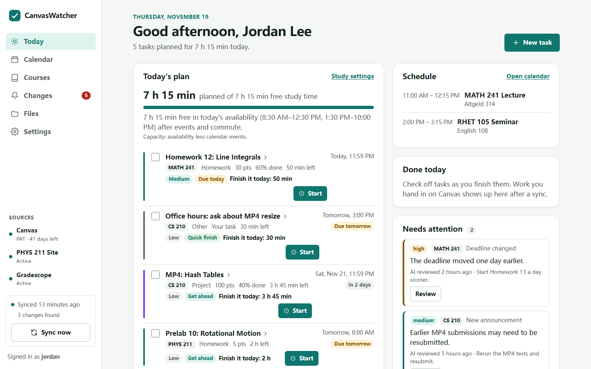
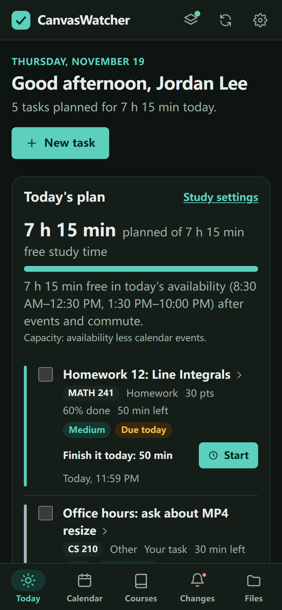
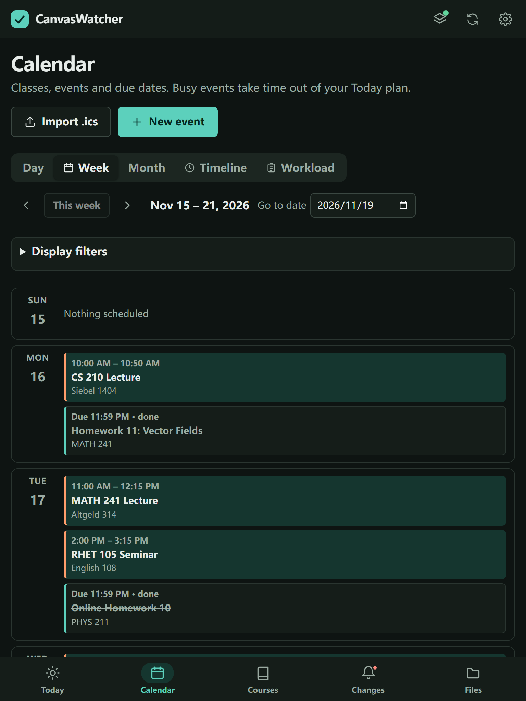
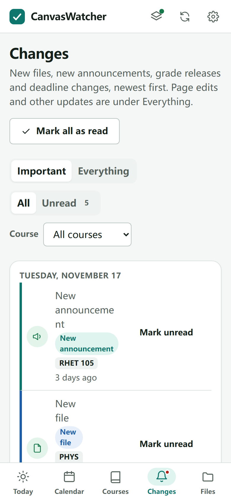
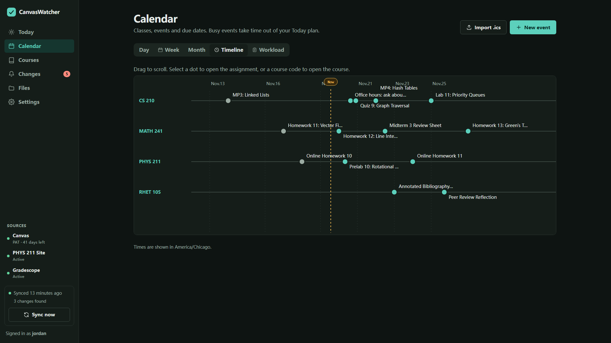
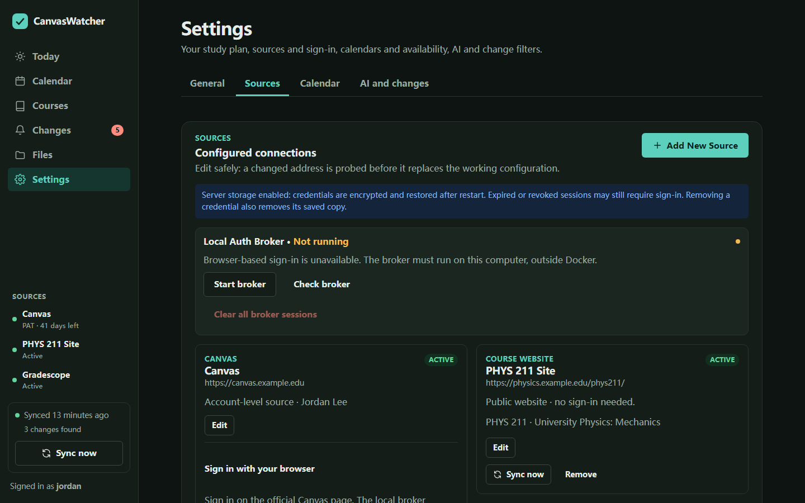

# CanvasWatcher / Academic Watcher

[中文说明](README.zh-CN.md) · [Changelog](CHANGELOG.md) · [GPL-2.0](LICENSE)

CanvasWatcher collects deadlines, tasks, files and meaningful changes from Canvas, course websites and Gradescope, and turns them into a daily study plan. It is a multi-user web app: a TypeScript REST API on Node.js (Express, PostgreSQL, Prisma) and a React interface that works from phones to wide monitors, in light and dark mode. Reading from sources is always read-only.

From **v0.8.0** this codebase is the official version. It covers everything the earlier Python app ([`legacy/`](legacy/README.md), kept only for reference) did, rebuilt for many accounts on one server.

| Desktop, light | Phone, dark |
| --- | --- |
|  |  |

| Tablet: calendar week | Phone: important changes |
| --- | --- |
|  |  |





*Screenshots use a fictional demo account.*

## What it does

**Sources** (Settings → Sources, and the SOURCES list in the sidebar)
- **Canvas** with three sign-in methods that back each other up: a personal access token (with its expiry date and reminders 7, 3 and 1 day before), a browser session, and OAuth when the server operator has a Canvas developer key. If one stops working the next verified one takes over; a token for a different Canvas account is refused instead of mixing data.
- **Browser sign-in through the Auth Broker**: a small helper on the student's computer ([`auth-broker/`](auth-broker/README.md)) opens the official sign-in page in its own browser profile, the student completes SSO and MFA there, and the helper hands the session to the server. CanvasWatcher never sees the password. A copied cURL request or Cookie header can be imported by hand instead.
- **Course websites**, public or protected with NTLM (username and password, sealed per user). Pages and files are crawled within the course's own path, files are checked (no login pages saved as PDFs) and kept within a per-user quota, protected pages that need sign-in are listed and retried after you authenticate, and an optional homework schedule table becomes dated tasks.
- **Gradescope**: sign in through the Auth Broker, link its courses to your courses, and see Gradescope's submission and deadline facts on the matching tasks ("deadlines differ" when they disagree). **PrairieLearn** sign-in is supported; reading its courses waits on verified sample data, as in the original.
- Each source shows its health and diagnostics, can be synced on its own or disabled, and raises a banner when it needs signing in again.

**Today**
- A plan for the free time left in your study availability after classes, other busy events and commute, with a reason and a priority for each task.
- Work timers with Start/Stop on any task (one running at a time; it survives closing the card and reports a lost connection), progress saved with conflict protection, Reopen for finished work, time used and time left from your pace, your estimate, or an AI estimate.
- Due next week, Done today, and **Needs attention**: important changes the AI reviewed, with what to do about them.
- Task cards show the Canvas description and an AI summary of it, linked assignment files to download, scores, and source facts.

**Calendar**: Day, Week and Month views, a course **Timeline** (swimlanes you can drag), and **Workload** per day. Your own events can repeat (RRULE), belong to a course and a type, and have a time zone; .ics files are previewed before import and can be re-imported, showing what is new, updated or removed. Settings → Calendar holds weekly study availability, date overrides, commute per course and the next 31 days.

**Courses**: term filter, archive and restore, grading policy from Canvas assignment groups, tasks by Active / Completed / Ignored, the course timeline, changes, files and the syllabus wherever the instructor put it.

**Changes**: new files, new announcements, grade releases and deadline changes by default (everything on request), with before and after. An optional AI review decides what is worth a notification; noise filters it learns can be disabled, restored or removed, with their history.

**Files**: search, filter by type (lecture, homework, discussion, reading, exam, solution, other), move a file to another type, download.

**AI** (optional): connect your own provider in Settings → AI and changes (Kimi, DeepSeek, Qwen, GLM, GPT, Claude; the key is sealed and never shown again, and a model must pass a test before it is used) or use the server's default. AI Chat keeps conversations on the server, reads your courses, tasks, syllabus, calendar, changes and files through tools, renders math, and asks before changing anything: task progress and completion, ignoring tasks, archiving courses and calendar events all need your confirmation.

**Preview accounts** let people without an account look around with a scrubbed copy of a real account (`PREVIEW_SOURCE_USERNAME`); everything that would reach Canvas or another site is greyed out.

## Run the whole stack

Install Docker (Docker Desktop, or Docker Engine with Compose v2), then:

```sh
cp .env.example .env    # set SESSION_SECRET and CREDENTIALS_KEY (see the comments in the file)
docker compose up -d --build
```

Open `http://localhost:8080`. nginx serves the interface and forwards `/api` to the API container, which applies database migrations when it starts. PostgreSQL listens on `127.0.0.1:5432` only (`POSTGRES_PORT` changes it).

To serve under a path such as `https://example.com/canvaswatcher/` behind another reverse proxy, set `PUBLIC_BASE_PATH=/canvaswatcher` and rebuild; the proxy must forward the path unchanged. If it sets `X-Forwarded-For`, raise `TRUST_PROXY` by one for `backend` in a Compose override.

Settings worth knowing (all in `.env.example`, with comments):

| Variable | Purpose |
| --- | --- |
| `CREDENTIALS_KEY` | Encrypts every stored secret (tokens, sessions, website passwords, AI keys). Losing it means users sign in to their sources again |
| `CANVAS_ALLOWED_HOSTS` | Canvas sites users may connect (default `canvas.illinois.edu,*.instructure.com`) |
| `SYNC_INTERVAL_MINUTES` | Minutes between automatic syncs of each account's sources (0 turns the scheduler off) |
| `AUTH_BROKER_URL` | Where the browser finds the Auth Broker (default `http://127.0.0.1:8765`) |
| `CANVAS_OAUTH_CLIENT_ID`, `_SECRET`, `_REDIRECT_URI` | Turn on Canvas OAuth with your institution's developer key |
| `WEBSITE_STORAGE_QUOTA_MB`, `WEBSITE_MAX_FILE_MB` | Per-user storage for course-website files (1024 MB, 25 MB per file) |
| `SOURCES_ALLOW_PRIVATE_HOSTS` | Allow course websites on private network addresses (off; turn on only for an intranet you trust) |
| `AI_API_KEY`, `AI_BASE_URL`, `AI_MODEL` | The server's default AI provider (OpenAI-compatible; empty key: users must bring their own) |
| `AI_ALLOW_LOCAL` | Offer local Ollama models in the provider list (off on hosted servers) |
| `PREVIEW_SOURCE_USERNAME` | The account previews copy; empty turns previews off |

### The Auth Broker

Browser sign-in for Canvas, Gradescope and PrairieLearn needs the Auth Broker on the student's own computer (Windows, macOS or Linux, Python 3.12 and Playwright's Chromium). On Windows it can be registered once so that **Start broker** in Settings → Sources launches it:

```powershell
py -3.12 -m venv auth-broker/.venv
auth-broker/.venv/Scripts/python.exe -m pip install -e ./auth-broker
auth-broker/.venv/Scripts/python.exe -m playwright install chromium
auth-broker/.venv/Scripts/python.exe -m academic_watcher_auth_broker.install_launcher install --backend https://example.com/canvaswatcher --origin https://example.com
```

`--backend` is the site's address including its base path, `--origin` the address the browser shows. Leave both out for a local Compose install. See [`auth-broker/README.md`](auth-broker/README.md) for manual mode, autostart and removal.

## Develop

Requires Node.js 22.12 or newer.

```sh
docker compose up -d db          # PostgreSQL only
cd server
cp .env.example .env             # set SESSION_SECRET and CREDENTIALS_KEY
npm install                      # also generates the Prisma client
npm run db:deploy                # apply migrations
npm run dev                      # API on http://localhost:8000, restarts on save
```

In another terminal, `cd frontend && npm install && npm run dev` serves the interface on `http://localhost:5173` and proxies `/api` to `localhost:8000` (`VITE_API_PROXY` changes it).

| Command | Does |
| --- | --- |
| `npm test` (server) | Creates and migrates `canvaswatcher_test`, then runs the Vitest + Supertest suite against fake Canvas, website and Gradescope servers |
| `npm run typecheck` (server) | Type-checks source and tests |
| `npm run bench` (server) | Request times and query plans on a large synthetic dataset ([performance.md](docs/cs409/performance.md)) |
| `npm test`, `npm run build` (frontend) | Interface tests; production build |
| `python -m pytest` (auth-broker) | The Auth Broker's tests |

CI (`.github/workflows/ci.yml`) runs the server checks against a PostgreSQL service and the frontend tests and build.

## API

All routes are under `/api` and act on the signed-in user's own data. Errors are JSON `{ "detail", "code" }`; validation errors return 422 with a list of `{ loc, msg }`. Sessions use an httpOnly cookie; requests that change something need an allowed `Origin` and the `X-AW-CSRF` header copied from the `aw_csrf` cookie. The Auth Broker's own calls (`/api/auth/broker/claim`, `/failed`, `/complete`) carry no session: they are bound to a single-use challenge instead.

| Area | Routes |
| --- | --- |
| Accounts | `POST /users`, `GET /users/me`, `PUT /users/me/password`, `POST /sessions`, `DELETE /sessions/current`, `GET\|POST /preview`, `POST /preview/reset` |
| Sources | `GET\|POST /sources`, `POST /sources/canvas`, `GET\|PATCH\|DELETE /sources/{id}`, `POST /sources/{id}/sync`; websites: `POST /sources/website/test`, `POST /sources/website`, `PUT /sources/website/{id}`, `GET /sources/{id}/website`, `POST\|DELETE /sources/{id}/website/credential`; Gradescope: `GET /sources/{id}/provider-courses`, `GET\|POST /sources/{id}/course-mappings`, `DELETE /sources/{id}/course-mappings/{course}`, `GET /sources/{id}/assignments`, `POST /sources/{id}/task-mappings`, `GET /sources/{id}/provider-facts`; `GET /settings/credential-storage` |
| Canvas sign-in | `GET /auth/canvas/status`, `POST /auth/canvas/pat`, `POST /auth/canvas/browser-session`, `DELETE /auth/canvas/methods/{method}?generation=`, `POST /auth/canvas/methods/{method}/verify`, `PUT /auth/canvas/preferred`, `DELETE /auth/canvas/credentials`, `GET /auth/canvas/oauth/capability`, `POST /auth/canvas/oauth/start`, `GET /auth/canvas/oauth/callback`; older clients: `GET\|PUT\|DELETE /canvas/connection` |
| Auth Broker | `GET /auth/broker/configuration`, `POST /auth/broker/challenges`, `/status`, `/cancel` (page); `POST /auth/broker/claim`, `/failed`, `/complete` (helper) |
| Sync | `POST /sync`, `GET /sync/runs/latest`, `GET /sync/runs/{id}` |
| Courses | `GET /courses[?term_id=&archived=]`, `GET /courses/terms`, `GET\|PATCH /courses/{id}`, `POST /courses/{id}/archive`, `/restore`, `GET /courses/{id}/syllabus`, `GET /courses/{id}/policy`, `PATCH /courses/{id}/commute` |
| Tasks and work | `GET\|POST /tasks`, `GET\|PATCH\|DELETE /tasks/{id}`, `POST /tasks/{id}/progress`, `GET /tasks/{id}/work`, `POST /tasks/{id}/work/start`, `/stop`, `/heartbeat`, `GET /work/active`, `POST /tasks/{id}/reestimate` |
| Today | `GET /today` |
| Calendar | `GET /calendar/events`, `/view`, `/capacity`, `/providers`; `POST /calendar/events`, `PATCH\|DELETE /calendar/events/{id}`; `GET\|POST /calendar/sources`, `POST /calendar/sources/preview`, `POST /calendar/sources/{id}/reimport`, `DELETE /calendar/sources/{id}`; `GET\|PUT /calendar/availability`, `GET /calendar/availability/overrides`, `PUT\|DELETE /calendar/availability/overrides/{date}` |
| Files | `GET /files[?course_id=&type=&q=&cursor=]`, `PATCH /files/{id}/classification`, `GET /files/{id}/download` |
| Changes | `GET /changes[?important=&course_id=&unread=&before=]`, `GET /changes/unread-count`, `POST /changes/mark-all-read`, `GET\|PATCH /changes/{id}`, `GET /changes/attention`, `POST /changes/reviews/run`; `GET /settings/change-filters`, `PATCH\|DELETE /settings/change-filters/{id}`; `GET /notifications`, `POST /notifications/{id}/dismiss` |
| Settings and AI | `GET\|PATCH /settings`; `GET\|PUT /settings/ai`, `POST\|DELETE /settings/ai/credential`, `POST /settings/ai/models`, `POST /settings/ai/test`; `GET /ai`, `POST /ai/chat`, `GET /ai/chat/conversations/{id}`, `POST /ai/chat/confirm`, `GET /ai/tasks/{id}/summary` |
| Health | `GET /health` |

## Source tree

| Path | Purpose |
| --- | --- |
| `server/src/routes/` | Express routes, one file per area |
| `server/src/canvas/` | Canvas client, credential slots and failover, syllabus finder |
| `server/src/sources/` | Source registry, course-website crawler and NTLM, Gradescope and PrairieLearn readers, task matching |
| `server/src/sync/`, `server/src/changes/` | Sync runs and scheduler; change taxonomy, AI review, filters |
| `server/src/calendar/`, `server/src/today/`, `server/src/tasks/` | Recurrence, availability and capacity; the daily plan; effort, timers and progress |
| `server/src/ai/` | Providers and presets, AI Chat tools and confirmations, summaries and estimates |
| `server/prisma/` | Database schema and migrations |
| `frontend/src/app/` | The React interface: `pages/`, `sources/` (Settings → Sources and the sidebar list), `ui.tsx`, `queries.ts`, `app.css` (design tokens, light and dark) |
| `auth-broker/` | The desktop Auth Broker for browser sign-in (Python) |
| `docs/` | Screenshots, performance measurements, course-project documents (`docs/cs409/`) |
| `legacy/` | The earlier Python app, kept for reference; not built or deployed |

## License

Released under the [GNU General Public License, version 2](LICENSE). Third-party dependencies keep their own licenses. Development involved AI coding agents under human-directed requirements and review.
