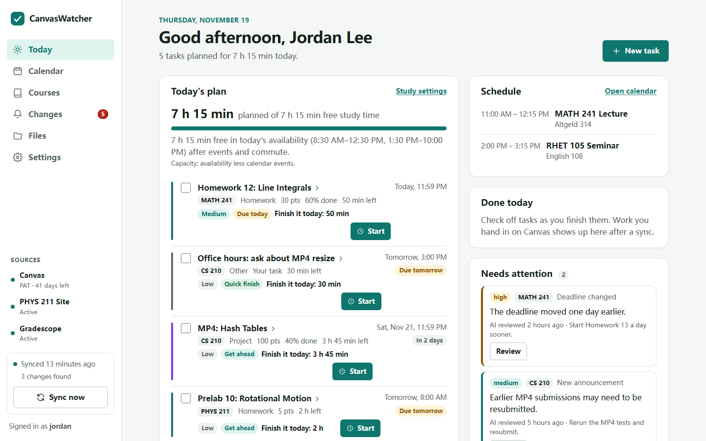
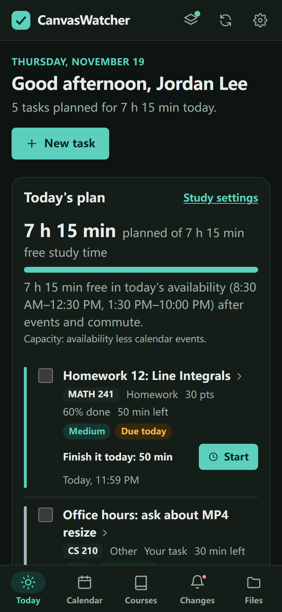
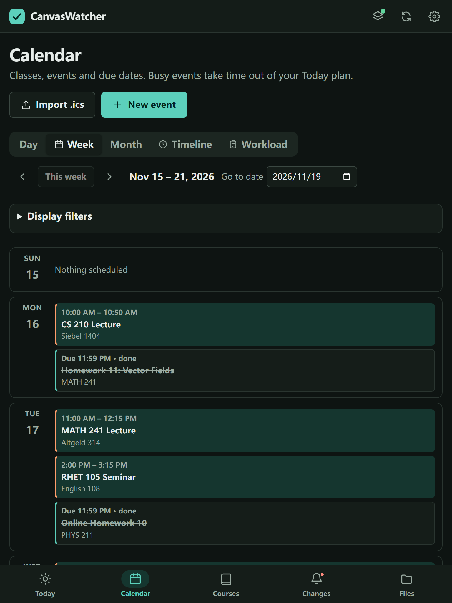
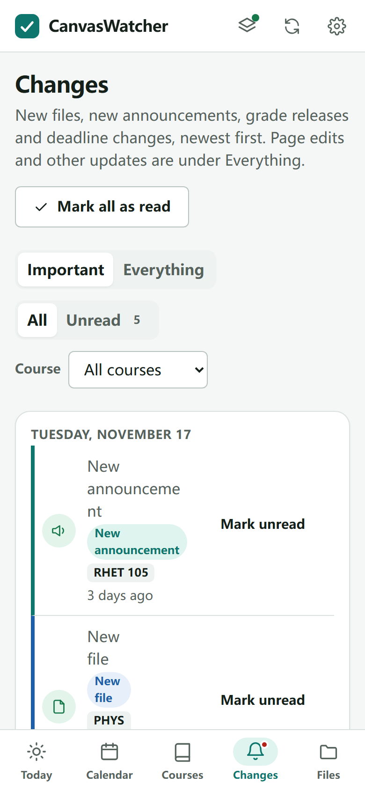
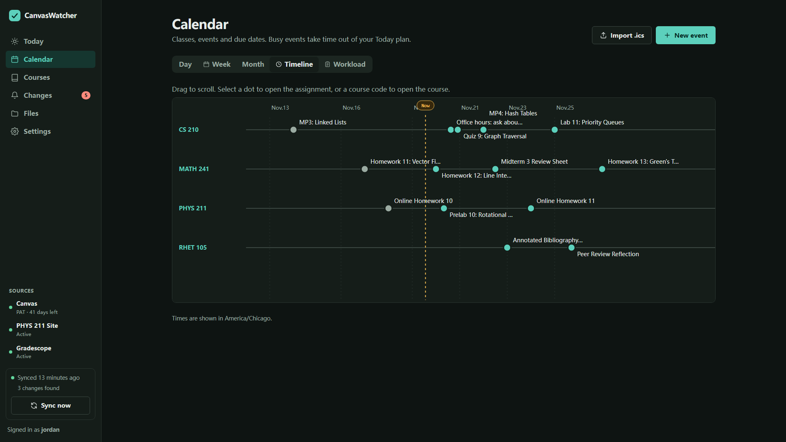
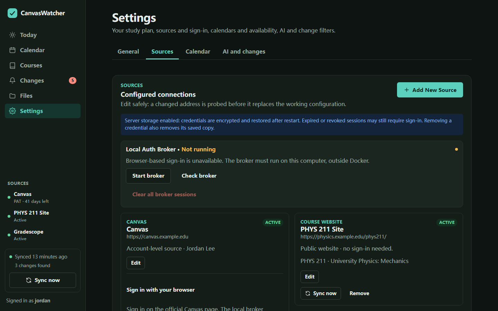

# CanvasWatcher / Academic Watcher

[English README](README.md) · [更新记录](CHANGELOG.md) · [GPL-2.0](LICENSE)

CanvasWatcher 从 Canvas、课程网站和 Gradescope 汇集截止日期、任务、文件和有意义的变更，并据此生成每日学习计划。它是一个多用户网页应用：后端是 Node.js 上的 TypeScript REST API（Express、PostgreSQL、Prisma），前端是 React，从手机到宽屏显示器都能正常使用，支持浅色和深色模式。对各来源的读取始终是只读的。

从 **v0.8.0** 起，本代码库即为正式版。它覆盖了早期 Python 版本（[`legacy/`](legacy/README.md)，仅作参考保留）的全部功能，并改造为一台服务器上的多账号应用。

| 桌面，浅色 | 手机，深色 |
| --- | --- |
|  |  |

| 平板：日历周视图 | 手机：重要变更 |
| --- | --- |
|  |  |





*截图使用虚构的演示账号。*

## 功能

**来源**（Settings → Sources，以及侧栏的 SOURCES 列表）
- **Canvas** 支持三种互为备份的登录方式：个人访问令牌（PAT，可填写到期日，到期前 7、3、1 天提醒）、浏览器会话，以及服务器配置了 Canvas 开发者密钥时的 OAuth。一种失效时自动换用下一种已验证的方式；属于另一个 Canvas 账号的令牌会被拒绝，不会混入数据。
- **通过 Auth Broker 用浏览器登录**：学生电脑上的小助手（[`auth-broker/`](auth-broker/README.md)）用独立的浏览器配置打开官方登录页，学生在那里完成 SSO 和多重验证，助手再把会话交给服务器。CanvasWatcher 不会接触密码。也可以手动导入复制的 cURL 请求或 Cookie 请求头。
- **课程网站**，公开或受 NTLM 保护均可（用户名和密码按用户加密保存）。只在课程自身的路径内抓取网页和文件；文件会经过校验（登录页不会被当作 PDF 保存），并受每用户存储配额限制；需要登录的受保护页面会列出来，登录后重试；作业进度表可选择转成带日期的任务。
- **Gradescope**：通过 Auth Broker 登录，把其中的课程关联到你的课程，在对应任务上看到 Gradescope 的提交和截止日期信息（两边截止日期不一致时会标出 "deadlines differ"）。**PrairieLearn** 支持登录；读取课程需等待经过验证的样本数据，和原版一致。
- 每个来源都显示健康状态和诊断信息，可以单独同步或停用；需要重新登录时会出现横幅提醒。

**Today**
- 在每周可用学习时间中扣除上课、其他忙碌事件和通勤后，用剩余空闲时间安排计划，每项任务都附有理由和优先级。
- 每个任务都可以开始/停止计时（同一时间只计一个；收起卡片后仍在计时，断线时会提示），进度保存带冲突保护，已完成的任务可以 Reopen。已用时间和剩余时间依次按你的进度节奏、你的估计或 AI 估计计算。
- Due next week、Done today，以及 **Needs attention**：经过 AI 审核的重要变更，附带建议的处理方式。
- 任务卡片显示 Canvas 作业说明及其 AI 概括、可下载的作业附件、分数和来源信息。

**日历**：日、周、月视图，可拖动的课程**时间线**（Timeline，泳道图），以及每日**工作量**（Workload）。自建事件可以重复（RRULE），可以关联课程、设置类型和时区；导入 .ics 前会先预览，之后可以重新导入，并显示新增、更新和删除了哪些事件。Settings → Calendar 中可设置每周学习时间、按日期覆盖、每门课的通勤时间，并查看未来 31 天的日程。

**课程**：按学期筛选，归档与恢复，来自 Canvas 作业分组的评分政策，按 Active / Completed / Ignored 查看任务，课程时间线、变更、文件，以及教师放在任何位置的教学大纲。

**变更**：默认只显示新文件、新公告、成绩发布和截止日期变化（也可查看全部），并给出变化前后的内容。可选的 AI 审核决定哪些变更值得通知；它学到的噪声过滤规则可以停用、恢复或删除，并保留修改历史。

**文件**：搜索，按类型筛选（lecture、homework、discussion、reading、exam、solution、other），把文件移到其他类型，下载。

**AI**（可选）：在 Settings → AI and changes 中连接你自己的服务商（Kimi、DeepSeek、通义千问、智谱 GLM、GPT、Claude；密钥加密保存且不再显示，模型必须先通过测试才会启用），或使用服务器默认配置。AI Chat 的对话保存在服务器上，通过工具读取你的课程、任务、教学大纲、日历、变更和文件，能渲染数学公式；修改任何内容前都会先询问：任务进度和完成状态、忽略任务、归档课程、日历事件都需要你确认。

**预览账号**：没有账号的人也能用一份去除身份信息的真实账号副本浏览（`PREVIEW_SOURCE_USERNAME`）；凡是会访问 Canvas 或其他网站的操作都会置灰。

## 运行完整服务

先安装 Docker（Docker Desktop，或带 Compose v2 的 Docker Engine），然后：

```sh
cp .env.example .env    # 设置 SESSION_SECRET 和 CREDENTIALS_KEY（见文件内注释）
docker compose up -d --build
```

打开 `http://localhost:8080`。nginx 提供前端页面并把 `/api` 转发给 API 容器，API 容器启动时会执行数据库迁移。PostgreSQL 只监听 `127.0.0.1:5432`（可用 `POSTGRES_PORT` 修改）。

如需部署在其他反向代理后面的子路径下，例如 `https://example.com/canvaswatcher/`，设置 `PUBLIC_BASE_PATH=/canvaswatcher` 后重新构建，代理须原样转发该路径。如果代理会设置 `X-Forwarded-For`，在 Compose 覆盖文件中把 `backend` 的 `TRUST_PROXY` 加一。

值得了解的配置（都在 `.env.example` 中，附有注释）：

| 变量 | 作用 |
| --- | --- |
| `CREDENTIALS_KEY` | 加密所有保存的秘密（令牌、会话、网站密码、AI 密钥）。丢失后用户需要重新登录各来源 |
| `CANVAS_ALLOWED_HOSTS` | 允许连接的 Canvas 站点（默认 `canvas.illinois.edu,*.instructure.com`） |
| `SYNC_INTERVAL_MINUTES` | 每个账号各来源自动同步的间隔分钟数（0 关闭定时同步） |
| `AUTH_BROKER_URL` | 浏览器访问 Auth Broker 的地址（默认 `http://127.0.0.1:8765`） |
| `CANVAS_OAUTH_CLIENT_ID`、`_SECRET`、`_REDIRECT_URI` | 使用学校的开发者密钥启用 Canvas OAuth |
| `WEBSITE_STORAGE_QUOTA_MB`、`WEBSITE_MAX_FILE_MB` | 课程网站文件的每用户存储空间（1024 MB，单个文件 25 MB） |
| `SOURCES_ALLOW_PRIVATE_HOSTS` | 允许私有网络地址上的课程网站（默认关闭；仅对可信的内网开启） |
| `AI_API_KEY`、`AI_BASE_URL`、`AI_MODEL` | 服务器默认的 AI 服务商（OpenAI 兼容接口；密钥留空则用户必须自带） |
| `AI_ALLOW_LOCAL` | 在服务商列表中提供本地 Ollama 模型（托管服务器上默认关闭） |
| `PREVIEW_SOURCE_USERNAME` | 预览账号复制的源账号；留空则关闭预览 |

### Auth Broker

Canvas、Gradescope 和 PrairieLearn 的浏览器登录需要在学生自己的电脑上运行 Auth Broker（Windows、macOS 或 Linux，需 Python 3.12 和 Playwright 的 Chromium）。在 Windows 上注册一次后，就可以在 Settings → Sources 中点 **Start broker** 启动它：

```powershell
py -3.12 -m venv auth-broker/.venv
auth-broker/.venv/Scripts/python.exe -m pip install -e ./auth-broker
auth-broker/.venv/Scripts/python.exe -m playwright install chromium
auth-broker/.venv/Scripts/python.exe -m academic_watcher_auth_broker.install_launcher install --backend https://example.com/canvaswatcher --origin https://example.com
```

`--backend` 是站点地址（含子路径），`--origin` 是浏览器地址栏显示的源。本地 Compose 部署时两者都可省略。手动模式、开机自启和卸载见 [`auth-broker/README.md`](auth-broker/README.md)。

## 开发

需要 Node.js 22.12 或更新版本。

```sh
docker compose up -d db          # 只启动 PostgreSQL
cd server
cp .env.example .env             # 设置 SESSION_SECRET 和 CREDENTIALS_KEY
npm install                      # 同时生成 Prisma client
npm run db:deploy                # 执行迁移
npm run dev                      # API 位于 http://localhost:8000，保存后自动重启
```

在另一个终端执行 `cd frontend && npm install && npm run dev`，前端位于 `http://localhost:5173`，`/api` 转发到 `localhost:8000`（可用 `VITE_API_PROXY` 修改）。

| 命令 | 作用 |
| --- | --- |
| `npm test`（server） | 创建并迁移 `canvaswatcher_test`，然后针对假的 Canvas、课程网站和 Gradescope 服务器运行 Vitest + Supertest 测试 |
| `npm run typecheck`（server） | 检查源码和测试的类型 |
| `npm run bench`（server） | 在大型合成数据集上测量请求耗时和查询计划（[performance.md](docs/cs409/performance.md)） |
| `npm test`、`npm run build`（frontend） | 前端测试；生产构建 |
| `python -m pytest`（auth-broker） | Auth Broker 的测试 |

CI（`.github/workflows/ci.yml`）在 PostgreSQL 服务上运行后端检查，并运行前端测试和构建。

## API

所有接口都在 `/api` 下，只操作当前登录用户自己的数据。错误以 JSON `{ "detail", "code" }` 返回；校验错误返回 422，`detail` 是 `{ loc, msg }` 列表。会话使用 httpOnly Cookie；会修改数据的请求需要允许的 `Origin`，以及从 `aw_csrf` Cookie 复制的 `X-AW-CSRF` 请求头。Auth Broker 自己发出的请求（`/api/auth/broker/claim`、`/failed`、`/complete`）不带会话，改为绑定到一次性的 challenge。

完整的接口列表见[英文 README 的 API 一节](README.md#api)。

## 目录结构

| 路径 | 用途 |
| --- | --- |
| `server/src/routes/` | Express 路由，每个功能区一个文件 |
| `server/src/canvas/` | Canvas 客户端、凭据槽与故障切换、教学大纲查找 |
| `server/src/sources/` | 来源注册表、课程网站爬取与 NTLM、Gradescope 和 PrairieLearn 读取、任务匹配 |
| `server/src/sync/`、`server/src/changes/` | 同步任务与定时器；变更分类、AI 审核、过滤规则 |
| `server/src/calendar/`、`server/src/today/`、`server/src/tasks/` | 重复规则、可用时间与容量；每日计划；工作量、计时器与进度 |
| `server/src/ai/` | 服务商与预设、AI Chat 工具与确认、作业概括与估时 |
| `server/prisma/` | 数据库结构与迁移 |
| `frontend/src/app/` | React 前端：`pages/`、`sources/`（Settings → Sources 和侧栏来源列表）、`ui.tsx`、`queries.ts`、`app.css`（设计变量，浅色和深色） |
| `auth-broker/` | 用于浏览器登录的桌面端 Auth Broker（Python） |
| `docs/` | 截图、性能测量、课程项目文档（`docs/cs409/`） |
| `legacy/` | 早期 Python 版本，仅作参考保留，不构建也不部署 |

## 许可证

以 [GNU General Public License 第 2 版](LICENSE) 发布。第三方依赖保留各自的许可证。开发过程中使用了 AI 编程代理，需求与审查由人主导。
